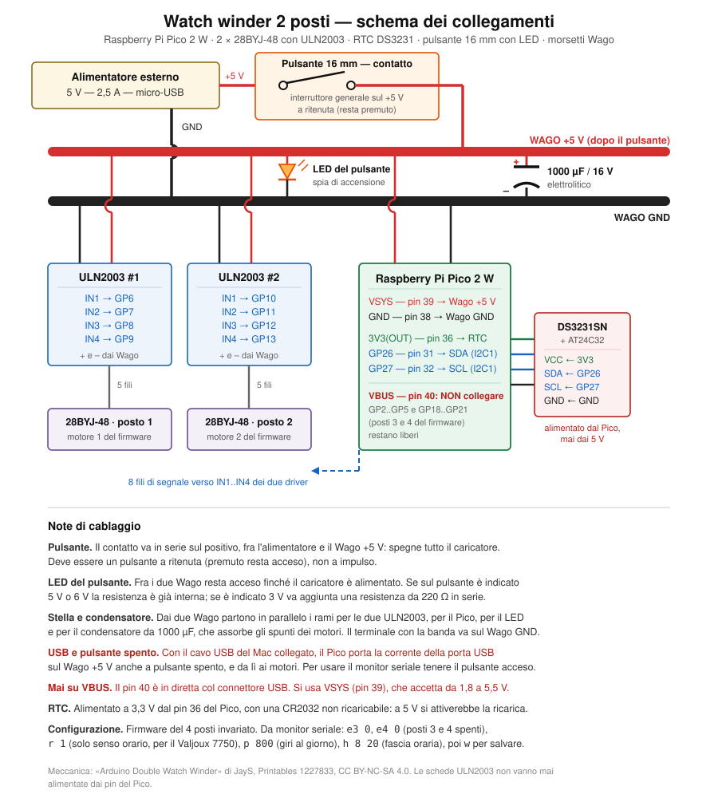

# Caricaorologi a 2 posti

Versione ridotta del caricaorologi: due posti invece di quattro. La meccanica
è il progetto **Arduino Double Watch Winder** di **JayS**, pubblicato su
Printables il 6 maggio 2025. L'elettronica e il firmware sono quelli del
caricatore a 4 posti di questo repository: Raspberry Pi Pico 2 W con orologio
in tempo reale (RTC) DS3231, configurati per due soli motori.



## Progetto originale

- **Titolo:** Arduino Double Watch Winder
- **Autore:** JayS (https://www.printables.com/@JayS)
- **Pagina:** https://www.printables.com/model/1227833-arduino-double-watch-winder
- **Licenza:** Creative Commons Attribuzione - Non commerciale - Condividi allo
  stesso modo 4.0 Internazionale (CC BY-NC-SA 4.0),
  https://creativecommons.org/licenses/by-nc-sa/4.0/deed.it
- **Strumenti usati dall'autore:** Arduino IDE e Autodesk Inventor

JayS è l'autore del modello 3D, dello schema dei collegamenti originale e del
codice originale per Arduino Uno.

## Licenze dei file di questa cartella

Nella cartella convivono due licenze.

**CC BY-NC-SA 4.0 (JayS)** — tutto ciò che viene dal progetto originale o ne
deriva: i file del modello, `code.ino`, `wiring.pdf`, la copia della pagina
Printables e lo sketch `watchwinder_nano/`, che è una modifica del codice di
JayS. Per questi file:

- bisogna sempre citare JayS e il link al progetto originale;
- non si possono vendere né il progetto né le sue modifiche;
- ogni modifica, comprese le parti 3D ritoccate, va distribuita con la stessa
  licenza CC BY-NC-SA 4.0.

**MIT (Carlo Comincini)** — lo sketch `watchwinder_2posti/`, lo schema
`schema-elettrico-2-posti.svg` e questo README. Lo sketch per il Pico non
deriva dal codice di JayS: è il firmware del caricatore a 4 posti con valori
di partenza diversi e una fascia oraria in più per il fine settimana, quindi
resta sotto la licenza MIT del repository.

## File

| File | Origine | Contenuto |
|------|---------|-----------|
| `watchwinder_2posti/` | Carlo Comincini | Firmware in uso, per Raspberry Pi Pico 2 W |
| `schema-elettrico-2-posti.svg` | Carlo Comincini | Schema dei collegamenti della versione in uso |
| `uhrenbeweger.3mf` | JayS | Progetto di stampa già orientato e con i supporti |
| `uhrenbeweger.step` | JayS | Parti principali in formato STEP, per le modifiche CAD |
| `code.ino` | JayS | Sketch originale per Arduino Uno, commenti in tedesco |
| `wiring.pdf` | JayS | Schema dei collegamenti originale (Fritzing) |
| `1227833-arduino-double-watch-winder-….pdf` | Printables | Copia della pagina del modello |
| `watchwinder_nano/` | modifica di JayS | Sketch per Arduino Nano, non in uso (vedi in fondo) |

I file del modello vengono dallo zip scaricato dalla pagina Printables.
`code.ino` e `wiring.pdf` sono pubblicati a parte, fra gli «Other files» della
stessa pagina, e sono stati scaricati l'11/10/2026.

## Materiale

Meccanica, come da progetto originale:

- 10 cuscinetti 603ZZ e 2 cuscinetti SMR85ZZ
- 22 dadi esagonali DIN 934 M3
- 22 viti a testa bombata ISO 7380 M3x6 e 18 M3x10 (testa alta al massimo 2 mm)

Elettronica, recuperata dal caricatore a 4 posti:

- Raspberry Pi Pico 2 W
- 2 motori passo-passo 28BYJ-48 con scheda driver ULN2003
- modulo RTC DS3231SN con EEPROM AT24C32 e batteria CR2032 **non ricaricabile**
- alimentatore 5 V 2,5 A, due morsetti Wago, condensatore elettrolitico
  1000 µF 16 V
- pulsante da 16 mm con LED, a ritenuta, usato come interruttore generale

Stampa: PLA, oppure PETG con un po' di rifinitura. Il file `.3mf` contiene
già orientamento e supporti.

## Collegamenti

| Pico 2 W | Collegato a |
|----------|-------------|
| GP6, GP7, GP8, GP9 | IN1, IN2, IN3, IN4 del driver del motore 1 |
| GP10, GP11, GP12, GP13 | IN1, IN2, IN3, IN4 del driver del motore 2 |
| GP26 (pin 31), GP27 (pin 32) | SDA e SCL del modulo RTC (bus I2C1) |
| 3V3(OUT) (pin 36), GND (pin 38) | VCC e GND del modulo RTC |
| VSYS (pin 39) | Wago +5 V |
| GND (pin 3) | Wago GND |
| VBUS (pin 40) | **nulla**: è in diretta con la presa USB |

Il contatto del pulsante è in serie sul positivo, fra l'alimentatore e il
Wago +5 V. Dai due Wago partono in parallelo i rami per le due schede ULN2003,
per il Pico, per il condensatore e per il LED del pulsante, che fa da spia di
accensione.

Due avvertenze nate dalla messa in funzione:

- **Fili del modulo RTC ben fissati.** Un contatto incerto sul GND del modulo,
  che con le vibrazioni dei motori si apriva per un attimo, azzerava
  l'orologio: il GND è in comune fra alimentazione e batteria, quindi
  staccandolo si perde anche l'ora. Conviene saldare i quattro fili o fermarli
  con colla a caldo.
- **USB e pulsante spento.** Con il cavo USB collegato il Pico porta la
  corrente della porta USB sul Wago +5 V anche a pulsante spento, e da lì ai
  motori. Per usare il monitor seriale tenere il pulsante acceso.

## Firmware e configurazione

Lo sketch è `watchwinder_2posti/watchwinder_2posti.ino`: deriva dal firmware
del caricatore a 4 posti (`../watchwinder/`), con questi valori di partenza:

| Parametro | Valore | Comando |
|-----------|--------|---------|
| Fascia oraria dal lunedì al venerdì | 08:00 - 21:00 | `h 8 21 10 21` |
| Fascia oraria sabato e domenica | 10:00 - 21:00 | (stesso comando) |
| Giri al giorno | 1600 | `p 1600` |
| Verso | entrambi, metà e metà | `r 0` |
| Intervallo fra i passi | 1900 µs | `v 1900` |
| Posti 3 e 4 | spenti | `e3 0`, `e4 0` |

Rispetto al 4 posti ci sono due differenze:

- **Fascia oraria per il fine settimana.** Il comando `h` accetta quattro
  numeri: inizio e fine dal lunedì al venerdì, poi inizio e fine il sabato e
  la domenica. Con due soli numeri (per esempio `h 9 20`) la stessa fascia
  vale tutti i giorni, e con inizio uguale alla fine (`h 0 0`) il caricatore
  lavora sempre. Il giorno della settimana viene ricavato dalla data
  dell'RTC. I giri al giorno restano gli stessi anche nei giorni con la
  fascia più corta: cambiano i giri di ogni quarto d'ora.
- **RTC cercato di nuovo.** Se all'accensione il modulo RTC non risponde (è
  successo dopo il collegamento del cavo USB), il firmware lo cerca ogni 5
  secondi invece di restare senza ora fino al riavvio successivo.

Per la fascia in più la configurazione salvata nella EEPROM del modulo RTC ha
un formato diverso da quella del 4 posti: spostando il modulo da una scatola
all'altra si riparte dai valori di fabbrica.

**Ora legale.** L'RTC non la gestisce: a fine marzo e a fine ottobre va
rimessa l'ora con il comando `T`, altrimenti le fasce slittano di un'ora.

**Perché 1600 giri in entrambi i versi.** Il Breitling Chronomat 81950 usa il
calibro Valjoux 7750, che carica in un solo verso e chiede circa 800 giri al
giorno. In questo caricatore «giroscopico» il verso di rotazione rispetto al
quadrante non è riconoscibile, quindi si gira in entrambi i versi con i giri
raddoppiati: almeno metà, circa 800, cadono nel verso utile. Il Seiko 5 carica
in entrambi i versi e a molla carica il meccanismo slitta senza danni. Ogni
quarto d'ora i due motori girano insieme per circa 4 minuti dal lunedì al
venerdì e per circa 4 minuti e 45 secondi il sabato e la domenica, quando la
fascia è più corta.

Comandi utili da monitor seriale (115200 baud, elenco completo con `?`):

- `s` stato completo, `t` ora e temperatura dell'RTC
- `T aaaa-mm-gg hh:mm:ss` imposta l'ora
- `h 8 21 10 21` fasce orarie dal lunedì al venerdì e il sabato e la domenica
- `f` lavora anche fuori fascia, per esempio per caricare un orologio fermo;
  `a` torna al funzionamento normale. Il comando `f` non viene salvato e si
  annulla a ogni riaccensione.
- `d1`, `d2` prova di tre giri del posto indicato
- `w` salva la configurazione

Compilazione da riga di comando, dalla cartella principale del repository:

```
arduino-cli compile --fqbn rp2040:rp2040:rpipico2w 2_orologi/watchwinder_2posti
```

## Versione originale per Arduino e sketch per Nano (non in uso)

Lo sketch originale di JayS (`code.ino`) gira su Arduino Uno: ogni quarto
d'ora fa compiere 12 o 13 giri a ciascun motore, sempre nello stesso verso
(circa 850 giri al giorno), e conta 17 ore di funzionamento e 8 di pausa a
partire dall'accensione, senza orologio. Il motore 1 è su D8-D11, il motore 2
su D4-D7, il LED del pulsante su D2.

`watchwinder_nano/` è lo stesso sketch adattato ad Arduino Nano, che ha gli
stessi pin dell'Uno, con una sola correzione: le bobine dei motori vengono
spente dopo ogni rotazione, mentre la libreria `Stepper` le lascia alimentate
(circa 400 mA continui e motori caldi). È stato provato su un Nano (scheda
Arduino Nano, processore ATmega328P) ma poi accantonato a favore del Pico, che
con l'RTC rispetta la pausa notturna anche dopo una mancanza di corrente.
