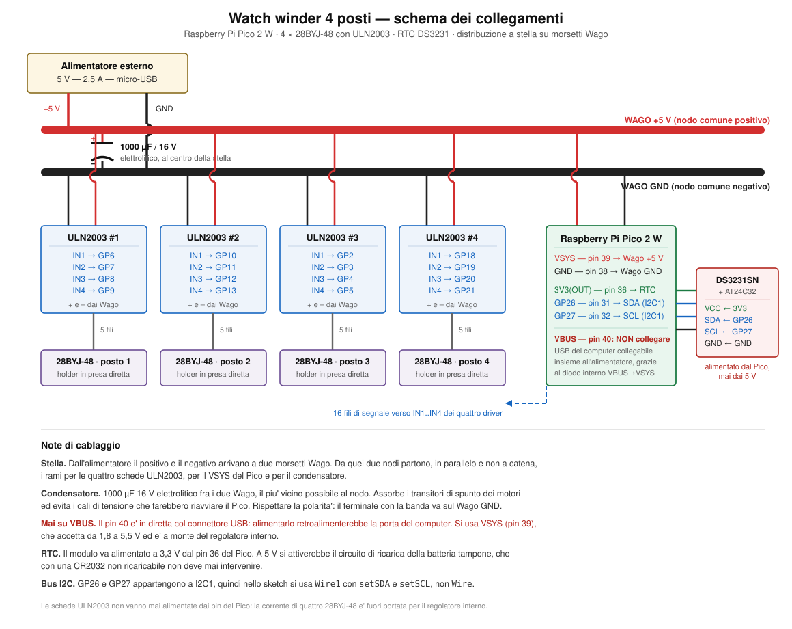

# Quad Watch Winder — Raspberry Pi Pico 2 W

Caricaorologi automatici a quattro posti: la meccanica è il modello 3D
**Quad Watch Winder** di **Karel**, l'elettronica e il firmware sono stati
rifatti da zero attorno a un **Raspberry Pi Pico 2 W** con orologio in tempo
reale (RTC) DS3231.

Il progetto nasce per due orologi con esigenze diverse ma compatibili, un
Seiko 5 con calibro automatico bidirezionale e un Breitling Chronomat degli
anni 80 su base Valjoux 7750, entrambi soddisfatti da **650 giri al giorno
(TPD, Turns Per Day) in modalità bidirezionale**.



---

## Attribuzioni

Questo repository è un lavoro derivato. Le parti meccaniche non sono opera
nostra e vanno attribuite ai rispettivi autori.

**Modello 3D originale:** [Quad Watch Winder](https://www.printables.com/model/25958-quad-watch-winder)
di **Karel**, pubblicato su Printables il 19 marzo 2020 e aggiornato il
12 aprile 2022. Licenza **Creative Commons Attribuzione - Non commerciale 4.0
Internazionale (CC BY-NC 4.0)**.

**Opera a monte:** Karel dichiara di essersi ispirato a
[thing:2021221](https://www.thingiverse.com/thing:2021221) di **Simone Dassi**,
da cui ha ripreso la forma del porta-orologio e del tappo, rimodellando poi
ogni parte da zero in Fusion 360.

**Elettronica e firmware di questo repository:** Carlo Comincini.

---

## Che cosa cambia rispetto al progetto originale

L'originale di Karel monta un **ATmega328P** programmato come "Arduino on
breadboard" nella configurazione minima, senza quarzo esterno, a 8 MHz, su una
basetta millefori. La configurazione avviene tramite un unico pulsante
luminoso con una sequenza di pressioni lunghe e brevi, e il ciclo è fisso:
dieci minuti di rotazione seguiti da cinquanta di pausa.

Qui l'elettronica è completamente diversa.

| | Originale (Karel) | Questo repository |
|---|---|---|
| Microcontrollore | ATmega328P a 8 MHz, senza quarzo | Raspberry Pi Pico 2 W (RP2350) |
| Base dei tempi | oscillatore interno del microcontrollore | RTC DS3231SN compensato in temperatura |
| Configurazione | pulsante luminoso, pressioni lunghe e brevi | menu testuale su porta seriale a 115200 baud |
| Memoria della configurazione | EEPROM interna dell'ATmega | EEPROM AT24C32 a bordo del modulo RTC |
| Ciclo | fisso, 10 minuti di moto e 50 di pausa | configurabile, di serie 15 minuti con la quota di giri necessaria ai TPD richiesti |
| Fascia oraria | assente | attivo dalle 09:00 alle 20:00, fermo di notte |
| Verso | orario, antiorario o spento per posto | bidirezionale, orario o antiorario, con inversione software per singolo posto |
| LED dei driver | rimossi dissaldando i resistori | lasciati al loro posto |

La differenza sostanziale è l'RTC: avere l'ora vera permette di fermare tutto
di notte e di ragionare in giri al giorno invece che in minuti di rotazione.

---

## Componenti

**Elettronica**

- Raspberry Pi Pico 2 W
- 4 × motore passo-passo 28BYJ-48 a 5 V con relativa scheda driver ULN2003
- modulo RTC DS3231SN con EEPROM AT24C32 integrata (i due dispositivi
  rispondono agli indirizzi I2C 0x68 e 0x57)
- batteria tampone CR2032 **non ricaricabile**
- alimentatore esterno 5 V 2,5 A con presa micro-USB
- condensatore elettrolitico 1000 µF 16 V
- 2 morsetti Wago, uno per il positivo e uno per il negativo

**Meccanica**, come da distinta del progetto originale

- 8 cuscinetti 623 (diametro interno 3 mm, esterno 10 mm, spessore 4 mm)
- 20 viti M3×10 a testa tonda e 4 viti M3×10 a testa svasata
- 16 dadi quadri M3

---

## Collegamenti

### Motori

Tutti e quattro i driver seguono lo stesso ordine crescente da IN1 a IN4.

| Motore | IN1 | IN2 | IN3 | IN4 |
|--------|------|------|------|------|
| 1 | GP6 | GP7 | GP8 | GP9 |
| 2 | GP10 | GP11 | GP12 | GP13 |
| 3 | GP2 | GP3 | GP4 | GP5 |
| 4 | GP18 | GP19 | GP20 | GP21 |

Se un motore vibra sul posto senza avanzare, l'ordine dei fili di quel driver è
sbagliato e va corretto sul cablaggio. Se invece gira bene ma nel verso
sbagliato, si rimedia via software con il comando `i<n> 1`.

### RTC — bus I2C1

| Pico 2 W | Modulo RTC |
|----------|------------|
| 3V3(OUT), pin 36 | VCC |
| GND | GND |
| GP26, pin 31 | SDA |
| GP27, pin 32 | SCL |

GP26 e GP27 appartengono al secondo bus I2C, quindi nello sketch si usa
`Wire1` con `setSDA` e `setSCL`, non `Wire`.

### Alimentazione

La distribuzione è **a stella**, non a catena: dall'alimentatore il positivo e
il negativo raggiungono due morsetti Wago, e da quei due nodi comuni partono in
parallelo tutti i rami.

Dal Wago positivo escono i rami verso le quattro schede ULN2003, verso il
**VSYS del Pico (pin 39)** e verso il positivo del condensatore. Dal Wago
negativo, allo stesso modo, i rami verso le quattro schede, verso il **GND del
Pico (pin 38)** e verso il negativo del condensatore.

Il **condensatore elettrolitico da 1000 µF 16 V** sta fra i due Wago, il più
vicino possibile al nodo. Serve ad assorbire i transitori di spunto dei motori,
che altrimenti fanno cadere la tensione quanto basta a riavviare il Pico.
Attenzione alla polarità: il terminale contrassegnato dalla banda va sul Wago
del negativo.

Tre regole da non violare.

**Mai alimentare il Pico su VBUS (pin 40).** Quel pin è in diretta col
connettore USB e retroalimenterebbe la porta del computer. VSYS accetta da 1,8
a 5,5 V ed è a monte del regolatore interno; il diodo Schottky interno fra VBUS
e VSYS permette di tenere collegato anche il cavo USB del computer mentre
l'alimentatore è attivo, cosa comoda per usare il monitor seriale.

**Mai alimentare le schede ULN2003 dai pin del Pico.** La corrente richiesta da
quattro 28BYJ-48 è fuori portata per il regolatore interno.

**La massa deve essere in comune** fra il Pico e le quattro schede driver.

### Batteria tampone dell'RTC

Va usata una **CR2032 comune, non ricaricabile**. I moduli di questo tipo
montano un circuito di ricarica composto da un diodo e da un resistore da
200 ohm, ma alimentando VCC a 3,3 V a valle del diodo restano circa 2,7 V, cioè
meno della tensione della CR2032: il diodo resta interdetto e la ricarica non
avviene mai. Non serve alcuna modifica al modulo.

Una LIR2032 ricaricabile sarebbe la scelta sbagliata: a 2,7 V non si
ricaricherebbe comunque, e offre circa 40 mAh contro i 220 mAh della CR2032.

Da qui discende la regola: **il VCC del modulo RTC deve restare su 3V3(OUT),
mai sui 5 V**, altrimenti il circuito di ricarica entrerebbe in funzione su una
batteria che non lo tollera.

---

## Firmware

Lo sketch è `watchwinder/watchwinder.ino`. Non usa librerie esterne: il DS3231
e la EEPROM AT24C32 sono gestiti con accesso diretto ai registri I2C.

### Ambiente

- core Arduino **Raspberry Pi Pico/RP2040** di Earle Philhower, versione 6.0.0
- FQBN `rp2040:rp2040:rpipico2w`

Verifica della compilazione da riga di comando:

```
arduino-cli compile --fqbn rp2040:rp2040:rpipico2w watchwinder
```

La prima programmazione va fatta in modalità UF2, tenendo premuto BOOTSEL
mentre si collega il cavo. Dopo il riavvio compare una porta `usbmodem`, ed è
quella da usare per il monitor seriale e per i caricamenti successivi.

### Come lavora

Il winder è attivo nella fascia oraria impostata, di serie dalle 09:00 alle
20:00, e resta fermo di notte. Il tempo è diviso in cicli di 15 minuti e in
ogni ciclo ciascun motore compie la propria quota di giri, ricavata dai TPD
richiesti: con 650 TPD su undici ore di attività sono circa 14,8 giri per
ciclo, divisi a metà fra senso orario e senso antiorario.

Le partenze dei quattro motori sono **sfalsate di pochi secondi**, quanto basta
a non far coincidere gli spunti, che sono il transitorio di corrente peggiore.
I motori lavorano quindi praticamente in parallelo e concentrano il rumore in
una finestra breve: con i valori di serie la scatola resta silenziosa per circa
l'85% del ciclo. Con `o 0` si torna alla vecchia strategia di un motore per
volta, con le partenze distribuite su quarti di ciclo.

A riposo le bobine sono sempre diseccitate, quindi non c'è consumo né
riscaldamento fra un ciclo e l'altro. Il 28BYJ-48 compie 4096 mezzi passi per
ogni giro dell'albero di uscita e il porta-orologio è calzato direttamente
sull'albero, quindi il rapporto di trasmissione è 1 a 1.

### Comandi del monitor seriale

Il monitor va aperto a **115200 baud**. Il comando `?` stampa l'elenco
completo.

| Comando | Effetto |
|---------|---------|
| `?` | elenco dei comandi |
| `s` | stato completo del sistema |
| `t` | data, ora e temperatura lette dall'RTC |
| `T aaaa-mm-gg hh:mm:ss` | imposta l'orologio |
| `Tc` | imposta l'orologio all'ora di compilazione |
| `m1`..`m4` | prova un motore: un giro orario e uno antiorario |
| `d1`..`d4` | prova del verso: tre giri solo orari |
| `x` | ferma tutto |
| `a` | torna al funzionamento automatico |
| `f` | forza l'attività ignorando la fascia oraria |
| `h <ini> <fin>` | fascia oraria, per esempio `h 9 20` |
| `p <tpd>` | giri al giorno, per esempio `p 650` |
| `c <minuti>` | durata del ciclo |
| `o <secondi>` | sfalsamento fra le partenze, `o 0` per un motore per volta |
| `v <us>` | microsecondi fra un passo e l'altro |
| `r <verso>` | 0 bidirezionale, 1 solo orario, 2 solo antiorario |
| `g <rapporto>` | giri di motore per giro del porta-orologio |
| `e<n> <0\|1>` | abilita o disabilita un posto |
| `i<n> <0\|1>` | inverte il verso di un motore |
| `w` | salva la configurazione in EEPROM |
| `z` | ripristina i valori di fabbrica |

Le modifiche alla configurazione hanno effetto subito ma restano in memoria
volatile: vanno confermate con `w` per sopravvivere allo spegnimento.

### Messa a punto della velocità

Il parametro `v` merita attenzione. Sotto i 1200 µs il 28BYJ-48 comincia a
perdere passi, mentre valori più alti rendono la rotazione più lenta e
silenziosa. Attorno a certe velocità la struttura stampata entra in risonanza e
il motore diventa ruvido e rumoroso pur girando correttamente: se un posto
suona peggio degli altri, conviene provare qualche centinaio di microsecondi in
più o in meno prima di sospettare un guasto. Il comando `s` mostra sempre se le
sessioni chiudono dentro il ciclo con i valori scelti.

---

## Stampa 3D

I file sono in `quad-watch-winder-model_files/`, così come scaricati dalla
pagina Printables, con l'aggiunta di una variante del porta-orologio.

Le impostazioni consigliate dall'autore sono altezza di strato 0,3 mm,
riempimento al 15%, senza supporti e senza raft. I fori destinati ai cuscinetti
vanno filettati con un maschio M3.

**Variante del porta-orologio.** Il file `holder-foro-allargato.stl` è una
modifica dell'`holder.stl` originale: il foro in cui si innesta l'albero del
motore è stato allargato con un **offset di 0,1 mm applicato a tutte le facce
del foro**, cioè due decimi complessivi sul diametro. Serve a compensare le
tolleranze di stampa e a far entrare l'albero del 28BYJ-48 senza forzare sulla
plastica, visto che qui il porta-orologio è calzato direttamente sull'albero
senza riduzioni. Il file `quad-watch-winder.f3d` è il sorgente Fusion 360 da
cui rigenerare quella variante, per chi volesse un offset diverso, adatto alla
propria stampante.

---

## Licenze e attribuzioni

Il repository contiene materiale con due licenze diverse.

**Firmware e documentazione** — cartella `watchwinder/`, cartella `doc/`,
`README.md` e schemi elettrici: copyright 2026 Carlo Comincini, licenza
**MIT**, vedi [LICENSE](LICENSE).

**Parti 3D** — cartella `quad-watch-winder-model_files/`, comprese le parti
modificate: opera di **Karel**, licenza **CC BY-NC 4.0**, attribuzione
obbligatoria e **uso commerciale non consentito**. Vedi
[quad-watch-winder-model_files/LICENSE-3D.md](quad-watch-winder-model_files/LICENSE-3D.md).

Chi riutilizza questo repository è tenuto a rispettare entrambe le licenze:
il firmware è liberamente riutilizzabile anche in ambito commerciale, le parti
stampate no.
